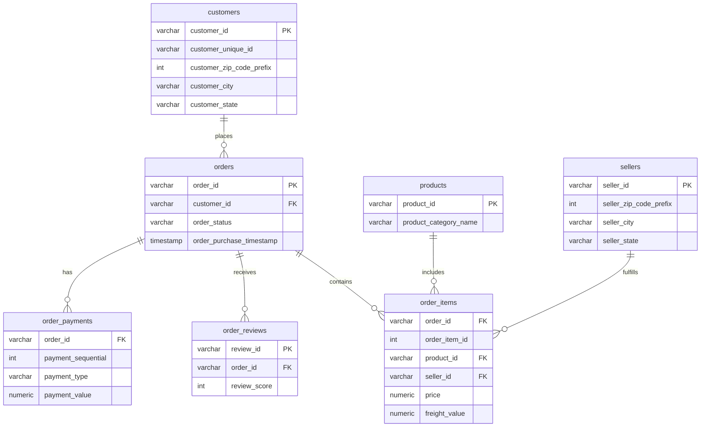

# Brazilian E-Commerce Analysis — PostgreSQL

## 📌 Project Overview

This project analyzes the **Brazilian E-Commerce Public Dataset by Olist** using **PostgreSQL** and SQL.

The goal is to explore e-commerce sales, customer behavior, product performance, seller performance, and order fulfillment through SQL-based analysis.

The project is designed to demonstrate practical SQL skills, from basic data exploration and data quality checks to advanced queries using CTEs, subqueries, and window functions.

---

## 🛠️ Tools & Technologies

- PostgreSQL
- pgAdmin 4
- SQL
- GitHub

---

## 📊 Dataset

The project uses the **Brazilian E-Commerce Public Dataset by Olist**, a public dataset containing approximately 100,000 orders from the Brazilian e-commerce marketplace.

The dataset contains information about:

- Customers
- Orders
- Order items
- Products
- Sellers
- Payments
- Reviews
- Customer locations

### Data Source

[Olist Brazilian E-Commerce Public Dataset — Kaggle](https://www.kaggle.com/datasets/olistbr/brazilian-ecommerce)

The raw CSV files are not included in this repository.

---

## 🏗️ Database Schema & Table Relationships

The following diagram illustrates the relationships between the seven tables used in this project.

### Key Relationships

| Relationship | Join Key | Description |
|---|---|---|
| Customers → Orders | `customer_id` | Connects customers to their orders |
| Orders → Order Payments | `order_id` | Connects orders to payment records |
| Orders → Order Reviews | `order_id` | Connects orders to customer reviews |
| Orders → Order Items | `order_id` | Connects orders to purchased items |
| Order Items → Products | `product_id` | Connects purchased items to product information |
| Order Items → Sellers | `seller_id` | Connects purchased items to seller information |

### Data Considerations

- `customer_id` identifies a customer record associated with an order, while `customer_unique_id` identifies the same customer across multiple orders.
- An order can contain multiple items and payment records.
- Payment and review data should be handled carefully when joining with order items to avoid duplicate rows and inflated calculations.
- Product revenue is calculated using `order_items.price`, while payment value is analyzed separately using `order_payments.payment_value`.

**Note:** The PK/FK labels in the diagram represent logical relationships based on the dataset. They do not necessarily mean that database constraints have been explicitly created in PostgreSQL.

---
## 🔎 Analysis Questions & SQL Skills

The project explores e-commerce sales performance, customer behavior, product performance, seller performance, and order fulfillment using PostgreSQL.

| # | Analysis Section | Business Questions | SQL Skills Demonstrated | SQL File |
|---|---|---|---|---|
| 1 | **Data Exploration** | Customer, order, product and seller counts; order status distribution; customer distribution by state | `COUNT()`, `DISTINCT`, `GROUP BY`, `ORDER BY`, `CREATE TABLE` | [`01_data_exploration.sql`](./01_data_exploration.sql) |
| 2 | **Sales Analysis** | Total revenue, average order value, monthly revenue trends, top categories and sellers | `SUM()`, `AVG()`, `JOIN`, `GROUP BY`, `CTE`, `LAG()`, `DATE_TRUNC()` | [`02_sales_analysis.sql`](./02_sales_analysis.sql) |
| 3 | **Customer Analysis** | Highest-value customers, order frequency, repeat purchase rate, revenue contribution and time to second purchase | `JOIN`, `CTE`, `CASE WHEN`, `COUNT(DISTINCT)`, `ROW_NUMBER()`, `MAX()`, `PERCENTILE_CONT()` | [`03_Customer_analysis.sql`](./03_Customer_analysis.sql) |
| 4 | **Product & Seller Analysis** | Average selling price by category, seller revenue and seller performance against customer reviews | `JOIN`, `SUM()`, `AVG()`, `GROUP BY`, `COUNT(DISTINCT)`, CTE, `RANK`, `PARTITION` | [`04_Product_and_seller_analysis.sql`](./04_Product_and_seller_analysis.sql) |
| 5 | **Delivery & Review Analysis** | Late delivery rate, average delivery time, delivery performance by state and relationship between delivery time and review scores | Planned | Coming soon |

### SQL Techniques Covered

- **Data Retrieval & Aggregation:** `SELECT`, `WHERE`, `COUNT()`, `SUM()`, `AVG()`, `GROUP BY`
- **Data Integration:** `INNER JOIN`, `LEFT JOIN`
- **Query Structuring:** Common Table Expressions (CTEs)
- **Window Functions:** `LAG()`, `ROW_NUMBER()`
- **Conditional Logic:** `CASE WHEN`
- **Statistical Analysis:** `PERCENTILE_CONT()`
- **Date Analysis:** `DATE_TRUNC()`

